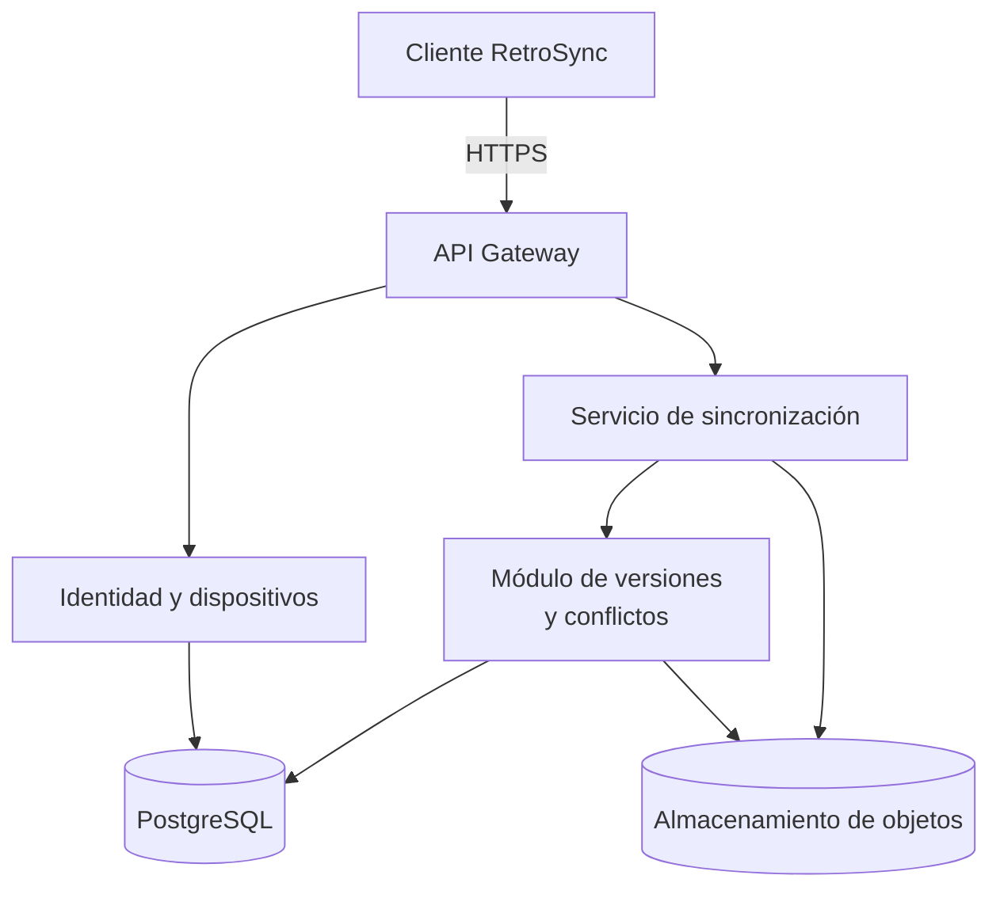

**Autor**: Jose Ruz Domínguez
# **RetroSync**: Sincronización cloud de partidas guardadas para emuladores retro.

## 1. **Descripción del Dominio**

Actualmente, existen muchos videojuegos de consolas antiguas cuyo acceso se ha vuelto difícil debido a la descontinuación del hardware que permite ejecutarlo. Los usuarios han creado emuladores que permiten replicar de forma virtual dicho hardware. Esto permite utilizar copias físicas de los juegos para extraer el software y usarlo en estos emuladores para ejecutarlos en sistemas modernos.

El uso de copias de software permite a los usuarios  utilizar emuladores en varios dispositivos con el mismo videojuego. El problema es que el emulador almacena las partidas guardadas de forma local, por lo que si se desea continuar el progreso en otro dispositivo se debe transferir dicha partida de forma manual. Esto no solo es tedioso, sino que puede provocar pérdida de progreso, sobreescrituras y divergencias entre dispositivos.

La aplicación **RetroSync** propone desarrollar una solución *cloud* que permita sincronizar partidas guardadas de diferentes videojuegos entre varios dispositivos. Esto reduce el problema de las transferencias manuales, habilitando una experiencia de juego continua entre varios sistemas sin preocupaciones por las pérdidas de progreso. 

Además, se pone al servicio del usuario una aplicación web donde puede consultar y gestionar las versiones de las partidas guardadas. Opcionalmente, se permitirá a los usuarios contratar un servicio extra para poder jugar en dichas partidas mediante streaming en los servidores de **RetroSync**. Los usuarios deberán proporcionar sus copias digitales del videojuego y podrán hacer usos de los recursos del servidor para jugar donde quieran. 

### **Casos de uso**

| ID    | Caso de uso                                    | Funcionalidad                                                                                                                              |
| ----- | ---------------------------------------------- | ------------------------------------------------------------------------------------------------------------------------------------------ |
| CU-1  | Registrar un dispositivo                       | El usuario incorpora un dispositivo autorizado.                                                                                            |
| CU-2  | Configurar directorio                          | Se selecciona el directorio local que almacena las partidas guardadas.                                                                     |
| CU-3  | Subir una partida                              | Se almacena la partida guardada en la nube con un identificador de juego asociado (id_juego) y un identificador de partida (id_partida).   |
| CU-4  | Descargar una partida                          | Se obtiene la partida guardada en la nube con el identificador indicado (id_partida) del juego asociado (id_juego).                        |
| CU-5  | Comparar versiones                             | Se compara la versión local de una partida con la última versión en la nube y se informa si está desactualiza o hay algún conflicto.       |
| CU-6  | Sincronización automática                      | Se guardan y descargan las partidas automáticamente para mantener todos los dispositivos actualizados mientras no haya conflictos.         |
| CU-7  | Resolver conflicto                             | Permite resolver conflictos entre archivos mediante la visualización de las diferencias y la selección de la copia que se desea conservar. |
| CU-8  | Revocar un dispositivo                         | Se impiden nuevas operaciones con el dispositivo indicado.                                                                                 |
| CU-9  | Eliminar partida guardada en la nube           | Se elimina la partida guarda en la nube con el indentificador indicado (id_partida).                                                       |
| CU-10 | Consultar partida guardada en la nube          | Se muestra la partida guardada en la nube con el identificador indicado (id_partida) y su información asociada.                            |
| CU-11 | Listar todas las partidas guardadas por juegos | Se muestran todas las partidas guardadas en la nube para un juego.                                                                         |
| CU-12 | Listar todos los juegos con partidas guardadas | Se muestran todos los juegos con partidas guardadas.                                                                                       |
| CU-13 | Usar servicio en streaming                     | Permite ejecutar la copia del juego identificado (id_juego) con la partida guardada indicada (id_partida).                                 |
| CU-14 | Registrar cuenta                               | Permite registrar una cuenta de usuario nueva en **RetroSync**.                                                                            |
| CU-15 | Iniciar sesión                                 | Permite iniciar sesión con una cuenta registrada en **RetroSync**.                                                                         |
| CU-16 | Cerra sesión                                   | Permite cerrar sesión en **RetroSync**.                                                                                                    |
| CU-17 | Contratar servicio                             | Permite contratar un plan de **RetroSync**.                                                                                                |
## 2. **Justificación NIST SP 800-145**
### 2.1. Autoservicio bajo demanda

Los usuarios podrán registrar dispositivos y solicitar operaciones de sincronización desde cualquier dispositivo. Además, podrán gestionar las partidas guardadas y hacer uso del servicio de streaming de **RetroSync** para jugar a las partidas de cualquier lugar.

### 2.2. Acceso amplio a la red

Los clientes autorizados se conectarán mediante HTTPS o FTP desde diferentes dispositivos. Se puede acceder desde dispositivos muy variados como teléfonos, tablets, ordenadores o dispositivos dedicados. 

### 2.3. Agrupación

Los servicios cloud compartirán una infraestructura gestionada por el proveedor. Los usuarios hacen uso del espacio compartido para almacenar las partidas y del hardware de procesamiento para streaming.

### 2.4. Rápida elasticidad

Los servicios de API podrán escalar horizontalmente según la demanda. Se permite escalar el almacenamiento en función del número de partidas del usuario. Las partidas guardadas son ligeras por lo que no se aplica un límite estricto a los usuarios. 

Por la parte del streaming, se permite escalar los recursos usados en función de las necesidades del emulador usado y los juegos ejecutados.
### 2.5. Servicio medido

Se medirán CPU, memoria, solicitudes, latencia, errores, almacenamiento utilizado y volumen de transferencias. Estos indicadores permitirán relacionar el uso de la plataforma con su coste operativo.

**Referencia:** NIST SP 800-145, *The NIST Definition of Cloud Computing*.
https://csrc.nist.gov/pubs/sp/800/145/final

## 3. **Mapeo de Actores NIST SP 500-292**

| Actor                              | Aplicación en RetroSync                                                                                 |
| ---------------------------------- | ------------------------------------------------------------------------------------------------------- |
| Consumidor cloud                   | Los usuarios que quieren almacenar las partidas guardas o el servicio de streaming.                     |
| Proveedor cloud                    | La organización que ofrece el almacenamiento para las partidas guardadas y los servidores de streaming. |
| Intermediario cloud (*broker*)     | Un posible servicio externo que agregue, compare u optimice recursos de varios proveedores.             |
| Auditor cloud                      | Una entidad que evalúa la seguridad, la privacidad y el rendimiento de los servicios ofrecidos.         |
| Operador de transporte (*carrier*) | Intermediario que proporciona conectividad.                                                             |

### Impacto económico

- **Consumidor:** paga, para almacenar y sincronizar las partidas. También puede pagar adicionalmente por el servicio de streaming.
- **Proveedor:** factura por el almacenamiento utilizado y el uso de los recursos para streaming.
- **Intermediario:** podría reducir costes mediante optimización de los servicios. Sin embargo, puede añadir costes o complejidad adicional.
- **Auditor:** implica un coste para verificar que los sistemas funcionen correctamente.
- **Operador de transporte:** aporta conectividad. Es importante ya que su infraestructura influirá en la sincronización del sistema.

**Referencia:** NIST SP 500-292, *NIST Cloud Computing Reference Architecture*.
https://www.nist.gov/publications/nist-cloud-computing-reference-architecture

## 4. **Diagrama de Arquitectura**

La plataforma se organiza en los siguientes componentes:

- **Cliente RetroSync:** aplicación de escritorio que observa directorios configurados por el usuario y realiza sincronizaciones.
- **API Gateway:** punto de entrada HTTPS y encaminamiento de peticiones.
- **Microservicio de identidad y dispositivos:** gestiona usuarios, sesiones y dispositivos autorizados.
- **Microservicio de sincronización:** coordina las operaciones de subida, descarga y comparación de estados.
- **Almacenamiento de objetos:** conserva los archivos de las partidas y sus versiones.
- **Microservicio de streaming**: gestiona el servicio de streaming.
- **Módulo de versiones y conflictos:** registra versiones inmutables, detecta divergencias y permite restauraciones.
- **PostgreSQL:** almacena metadatos, relaciones, manifiestos y estados de sincronización.

Cada partida tendrá un identificador estable y un manifiesto con su versión conocida. Las modificaciones incluirán una referencia a la versión base.

Si el cliente intenta actualizar una partida cuya versión remota ya ha cambiado, el servidor rechazará la actualización como conflictiva. Ambas versiones se conservarán para que el usuario pueda decidir cómo resolverla.




## 5. **API REST**

La API REST de **RetroSync** permite gestionar cuentas, dispositivos y partidas guardadas mediante HTTP y JSON. Todas las rutas utilizan el prefijo `/api/v1` y requieren autenticación, salvo el registro y el inicio de sesión.

| Método | Endpoint                                                                | Caso de uso                       |
| ------ | ----------------------------------------------------------------------- | --------------------------------- |
| POST   | `/auth/register`                                                        | CU-14: Registrar cuenta           |
| POST   | `/auth/login`                                                           | CU-15: Iniciar sesión             |
| POST   | `/auth/logout`                                                          | CU-16: Cerrar sesión              |
| POST   | `/devices`                                                              | CU-1: Registrar dispositivo       |
| DELETE | `/devices/{id}`                                                         | CU-8: Revocar dispositivo         |
| PUT    | `/config/directories/{id}`                                              | CU-2: Configurar directorio       |
| GET    | `/games`                                                                | CU-12: Listar juegos con partidas |
| GET    | `/games/{id_juego}/saves`                                               | CU-11: Listar partidas por juego  |
| POST   | `/games/{id_juego}/saves`                                               | CU-3: Subir partida               |
| GET    | `/games/{id_juego}/saves/{id_partida}/content`                          | CU-4: Descargar partida           |
| GET    | `/games/{id_juego}/saves/{id_partida}`                                  | CU-10: Consultar partida          |
| DELETE | `/games/{id_juego}/saves/{id_partida}`                                  | CU-9: Eliminar partida            |
| POST   | `/games/{id_juego}/saves/{id_partida}/compare`                          | CU-5: Comparar versiones          |
| POST   | `/games/{id_juego}/saves/{id_partida}/sync`                             | CU-6: Sincronizar partida         |
| POST   | `/games/{id_juego}/saves/{id_partida}/conflicts/{id_conflicto}/resolve` | CU-7: Resolver conflicto          |
| GET    | `/plans`                                                                | CU-17: Consultar planes           |
| POST   | `/account/subscription`                                                 | CU-17: Contratar plan             |

### Códigos HTTP

- `200 OK`: operación correcta.
- `201 Created`: recurso creado.
- `204 No Content`: operación correcta sin respuesta.
- `400 Bad Request`: solicitud incorrecta.
- `401 Unauthorized`: falta autenticación.
- `403 Forbidden`: acceso denegado.
- `404 Not Found`: recurso inexistente.
- `409 Conflict`: conflicto entre versiones.
- `500 Internal Server Error`: error interno.

### Payloads JSON

Los siguientes ejemplos muestran los datos enviados en las principales peticiones de RetroSync.

#### Registro y autenticación

**Registrar cuenta — CU-14**

```json
{
  "email": "usuario@example.com",
  "password": "PasswordSegura123"
}
```

**Iniciar sesión — CU-15**

```json
{
  "email": "usuario@example.com",
  "password": "PasswordSegura123"
}
```

#### Dispositivos y directorios

**Registrar dispositivo — CU-1**

```json
{
  "nombre": "PC principal",
  "sistema_operativo": "Windows 11"
}
```

**Configurar directorio — CU-2**

```json
{
  "ruta": "C:/Emuladores/RetroArch/saves",
  "id_juego": "game_001",
  "sincronizacion_automatica": true
}
```

#### Partidas guardadas

**Subir partida — CU-3**

```json
{
  "id_partida": "save_001",
  "nombre_archivo": "zelda.srm",
  "contenido_base64": "CONTENIDO_CODIFICADO",
  "hash": "sha256_del_archivo",
  "id_dispositivo": "device_001"
}
```

**Comparar versiones — CU-5**

```json
{
  "id_dispositivo": "device_001",
  "version_local": 2,
  "hash_local": "abc123"
}
```

**Sincronizar partida — CU-6**

```json
{
  "id_dispositivo": "device_001",
  "version_local": 2,
  "estrategia": "descargar_si_nube_es_mas_reciente"
}
```

**Resolver conflicto — CU-7**

```json
{
  "version_elegida": 3,
  "accion": "conservar_version_nube"
}
```

#### Contratación de planes

**Contratar plan — CU-17**

```json
{
  "id_plan": "premium"
}
```

## 6. **Bibliografía**

1. NIST SP 800-145: https://csrc.nist.gov/pubs/sp/800/145/final
2. NIST SP 500-292: https://www.nist.gov/publications/nist-cloud-computing-reference-architecture
