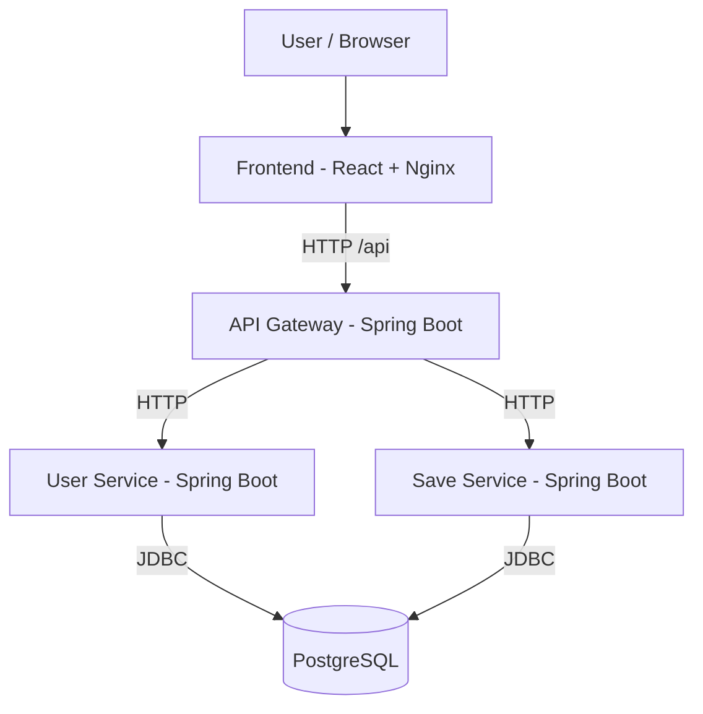

# RetroSync — System Architecture

## 1. Overview

RetroSync follows a containerized microservice architecture. The application is divided into independent backend services, a frontend application and a relational database.

The architecture separates user management from save file management, while an API Gateway provides a single entry point for frontend requests.

The main architectural goals are:

- Separation of responsibilities between services.
    
- Independent backend components.
    
- Centralized API access through the API Gateway.
    
- Persistent data storage.
    
- Reproducible local deployment using Docker Compose.
    
- Automated build and verification through GitHub Actions.
    

## 2. High-Level Architecture

The system consists of five main components:

1. **Frontend:** React application served by Nginx.
    
2. **API Gateway:** Central entry point for backend requests.
    
3. **User Service:** Handles user registration and login.
    
4. **Save Service:** Handles save file operations.
    
5. **PostgreSQL:** Stores user information and save metadata.
    

The frontend communicates exclusively with the API Gateway. The gateway forwards requests to the appropriate backend service.

## 3. Component Responsibilities

### 3.1 Frontend

**Technologies:** React, TypeScript, Vite and Nginx.

The frontend provides the application's user interface.

Its responsibilities include:

- User registration and login forms.
    
- Displaying the user's save files.
    
- Uploading save files.
    
- Downloading save files.
    
- Deleting save files.
    
- Managing the client-side user session.
    

During development, Vite provides the frontend development environment. In the containerized deployment, Nginx serves the production build.

Nginx also acts as a reverse proxy for API requests under `/api/`, forwarding them to the API Gateway.

### 3.2 API Gateway

**Technology:** Java 21 and Spring Boot.

The API Gateway is the single backend entry point exposed to the frontend.

Its responsibilities include:

- Receiving frontend HTTP requests.
    
- Forwarding user-related requests to the User Service.
    
- Forwarding save-related requests to the Save Service.
    
- Preserving relevant HTTP headers and response information.
    
- Returning backend responses to the frontend.
    

The gateway uses Spring MVC and `RestClient` to implement request forwarding.

Spring Cloud Gateway is not used. The routing and proxy behavior are implemented explicitly within the application.

### 3.3 User Service

**Technology:** Java 21, Spring Boot, Spring Data JPA and PostgreSQL.

The User Service manages user registration and login.

Its main responsibilities include:

- Registering new users.
    
- Validating email addresses and passwords.
    
- Preventing duplicate email registrations.
    
- Hashing passwords using BCrypt.
    
- Verifying login credentials.
    
- Persisting user information.
    

Main endpoints:

|Method|Endpoint|Description|
|---|---|---|
|POST|`/api/users/register`|Registers a new user|
|POST|`/api/users/login`|Verifies user credentials|

Passwords are stored as BCrypt hashes rather than plain text.

The current implementation verifies credentials but does not issue JWT tokens or establish a server-side authenticated session. The frontend maintains a simulated client-side session using `sessionStorage`.

### 3.4 Save Service

**Technology:** Java 21, Spring Boot, Spring Data JPA and PostgreSQL.

The Save Service manages uploaded video game save files.

Its responsibilities include:

- Receiving uploaded files.
    
- Generating unique identifiers for stored files.
    
- Saving file metadata in PostgreSQL.
    
- Listing saves associated with a user.
    
- Downloading stored files.
    
- Deleting files and their corresponding metadata.
    

Main endpoints:

|Method|Endpoint|Description|
|---|---|---|
|POST|`/api/saves/{userId}`|Uploads a save file|
|GET|`/api/saves/{userId}`|Lists a user's save files|
|GET|`/api/saves/{userId}/{saveId}/download`|Downloads a save file|
|DELETE|`/api/saves/{userId}/{saveId}`|Deletes a save file|

File contents are stored on disk, while their metadata is stored in PostgreSQL.

The service uses generated UUIDs for stored filenames to avoid relying on the original filename as the physical storage identifier.

### 3.5 PostgreSQL

**Technology:** PostgreSQL 17.

The application uses one PostgreSQL server with two separate databases:

|Database|Responsibility|
|---|---|
|`retrosync_users`|User information|
|`retrosync_saves`|Save file metadata|

Both databases run inside the same PostgreSQL container but maintain separate database schemas and application responsibilities.

The databases are initialized through the SQL script located at:

`infrastructure/postgres/init.sql`

## 4. Communication Between Components

The architecture uses HTTP communication between the frontend and backend components.

The request flow is:

1. The browser sends a request to the frontend.
    
2. Nginx serves the React application.
    
3. Requests under `/api/` are forwarded to the API Gateway.
    
4. The API Gateway determines the destination service based on the request path.
    
5. The selected microservice processes the request.
    
6. The service accesses PostgreSQL or the file system when necessary.
    
7. The response returns through the API Gateway to the frontend.
    

The gateway uses the following internal service addresses in Docker Compose:

|Service|Internal address|
|---|---|
|User Service|`http://user-service:8081`|
|Save Service|`http://save-service:8082`|
|API Gateway|`http://api-gateway:8080`|

Docker Compose provides a shared network that allows containers to communicate using their service names.

## 5. Data Storage and Persistence

RetroSync separates relational metadata from binary file contents.

### 5.1 Relational Data

PostgreSQL stores:

- User identifiers.
    
- Email addresses.
    
- Password hashes.
    
- User creation timestamps.
    
- Save identifiers.
    
- Save ownership identifiers.
    
- Original filenames.
    
- File sizes.
    
- Creation timestamps.
    
- Internal file storage paths.
    

### 5.2 File Storage

The Save Service stores uploaded files in its local container filesystem, under the configured storage directory.

In Docker Compose, this directory is mapped to a named volume:

`save_files:/app/uploads`

This ensures that uploaded files survive container recreation.

### 5.3 Docker Volumes

Two named volumes are configured:

|Volume|Purpose|
|---|---|
|`postgres_data`|PostgreSQL data persistence|
|`save_files`|Uploaded save file persistence|

Stopping the application with `docker compose down` does not remove these volumes.

Consequently, database records and uploaded files remain available when the application is started again.

## 6. Container Architecture

Each application component has its own Docker image.

The backend Dockerfiles use multi-stage builds:

1. A Maven image with Java 21 compiles the application.
    
2. A lightweight Java 21 JRE image runs the generated JAR.
    

The frontend Dockerfile also uses a multi-stage build:

1. Node.js builds the React application.
    
2. Nginx serves the generated production files.
    

Docker Compose orchestrates all five containers:

- `postgres`
    
- `user-service`
    
- `save-service`
    
- `api-gateway`
    
- `frontend`
    

The PostgreSQL health check is used to ensure the database is ready before the backend services start.

## 7. Network and Exposed Ports

The following ports are configured:

|Component|Container port|Host port|
|---|---|---|
|Frontend (Nginx)|80|3000|
|API Gateway|8080|8080|
|User Service|8081|Internal only|
|Save Service|8082|Internal only|
|PostgreSQL|5432|5432|

Only the frontend, API Gateway and PostgreSQL ports are published to the host.

The User Service and Save Service communicate internally through the Docker network.

## 8. Architectural Decisions and Trade-offs

### 8.1 Separate User and Save Services

User management and save file management have different responsibilities and data models.

Separating them makes the application easier to maintain and allows each service to evolve independently.

### 8.2 Manual API Gateway

Spring MVC and `RestClient` were selected instead of Spring Cloud Gateway.

This approach keeps the gateway implementation explicit and avoids introducing an additional framework dependency for the project's current requirements.

### 8.3 Shared PostgreSQL Server

A single PostgreSQL container with two separate databases reduces infrastructure complexity while preserving logical separation between user data and save metadata.

### 8.4 Filesystem Storage for Save Files

Binary files are stored on disk rather than directly inside PostgreSQL.

This keeps the database focused on structured metadata and allows file contents to be persisted independently through Docker volumes.

### 8.5 Docker Compose Instead of Kubernetes

Docker Compose was selected to provide a reproducible local environment with a limited operational footprint.

Kubernetes orchestration was not required for the current project scope.

### 8.6 Authentication Limitations

The current authentication implementation is intended for the project MVP.

Login verifies credentials, but there is no JWT issuance, server-side session management or token-based authorization between services.

The Save Service currently receives the user identifier through the request path. This is not a production-grade authorization mechanism and would need to be strengthened before a real public deployment.

## 9. Current Architecture Scope

The current implementation includes:

- Three Spring Boot backend services.
    
- A React frontend served by Nginx.
    
- A manually implemented API Gateway.
    
- PostgreSQL with two application databases.
    
- Persistent file storage using Docker volumes.
    
- Docker Compose orchestration.
    
- GitHub Actions continuous integration.
    

The following technologies and capabilities are outside the current MVP scope:

- Kubernetes.
    
- Kafka or other message brokers.
    
- Redis.
    
- JWT-based authentication.
    
- Distributed tracing.
    
- Service mesh.
    
- Object storage systems.
    

These could be considered in future iterations if the application's requirements grow.

## 10. Conclusion

RetroSync demonstrates a containerized microservice architecture with clear separation of responsibilities, centralized API access, relational persistence and persistent file storage.

The application can be built and executed locally using Docker Compose, while GitHub Actions automates backend verification and frontend builds.

The architecture provides a practical foundation for understanding and applying Cloud Native development principles within the scope of the project.
